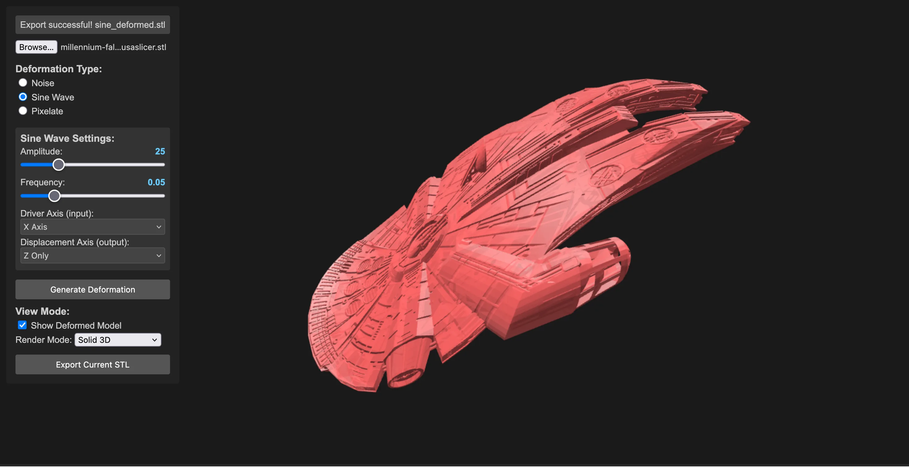
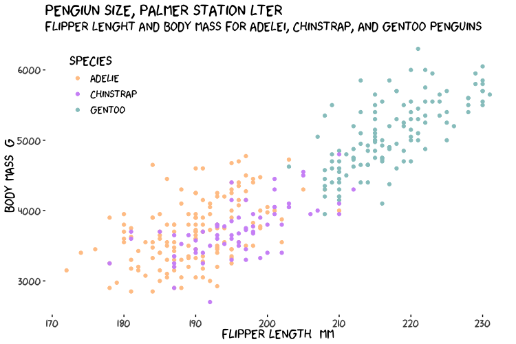
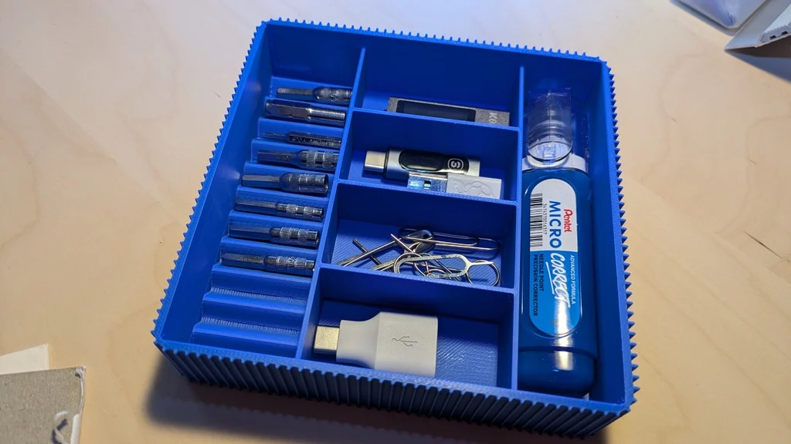
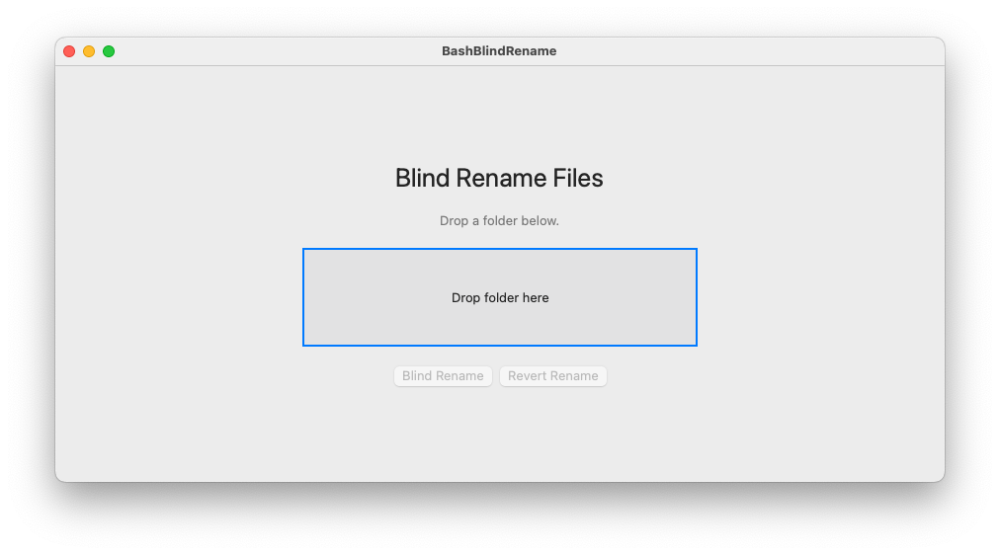

<!-- The whole site is this one page. Sections are plain HTML blocks
     styled by assets/page_design.css; behaviour comes from assets/design_code.js.
     Add a project: copy an <article class="tm-card"> and set data-tags.
     Add a paper: copy a 
 into its year. -->

<nav class="tm-nav" aria-label="Sections">
  <a class="tm-nav__brand" href="#top">Enrique M. Toledo</a>
  <ul class="tm-nav__links">
    <li><a href="#about">About</a></li>
    <li><a href="#projects">Projects</a></li>
    <li><a href="#papers">Papers</a></li>
    <li><a href="#connect">Connect</a></li>
  </ul>
  

    <a class="tm-icon-btn" href="https://www.linkedin.com/in/enrique-toledo/" aria-label="LinkedIn" title="LinkedIn" rel="noopener"><svg viewBox="0 0 24 24" fill="currentColor"><path d="M20.447 20.452h-3.554v-5.569c0-1.328-.027-3.037-1.852-3.037-1.853 0-2.136 1.445-2.136 2.939v5.667H9.351V9h3.414v1.561h.046c.477-.9 1.637-1.85 3.37-1.85 3.601 0 4.267 2.37 4.267 5.455v6.286zM5.337 7.433c-1.144 0-2.063-.926-2.063-2.065 0-1.138.92-2.063 2.063-2.063 1.14 0 2.064.925 2.064 2.063 0 1.139-.925 2.065-2.064 2.065zm1.782 13.019H3.555V9h3.564v11.452zM22.225 0H1.771C.792 0 0 .774 0 1.729v20.542C0 23.227.792 24 1.771 24h20.451C23.2 24 24 23.227 24 22.271V1.729C24 .774 23.2 0 22.222 0h.003z"/></svg></a>
    <a class="tm-icon-btn" href="https://github.com/ToledoEM/" aria-label="GitHub" title="GitHub" rel="noopener"><svg viewBox="0 0 24 24" fill="currentColor"><path d="M12 .297c-6.63 0-12 5.373-12 12 0 5.303 3.438 9.8 8.205 11.385.6.113.82-.258.82-.577 0-.285-.01-1.04-.015-2.04-3.338.724-4.042-1.61-4.042-1.61C4.422 18.07 3.633 17.7 3.633 17.7c-1.087-.744.084-.729.084-.729 1.205.084 1.838 1.236 1.838 1.236 1.07 1.835 2.809 1.305 3.495.998.108-.776.417-1.305.76-1.605-2.665-.3-5.466-1.332-5.466-5.93 0-1.31.465-2.38 1.235-3.22-.135-.303-.54-1.523.105-3.176 0 0 1.005-.322 3.3 1.23.96-.267 1.98-.399 3-.405 1.02.006 2.04.138 3 .405 2.28-1.552 3.285-1.23 3.285-1.23.645 1.653.24 2.873.12 3.176.765.84 1.23 1.91 1.23 3.22 0 4.61-2.805 5.625-5.475 5.92.42.36.81 1.096.81 2.22 0 1.606-.015 2.896-.015 3.286 0 .315.21.69.825.57C20.565 22.092 24 17.592 24 12.297c0-6.627-5.373-12-12-12"/></svg></a>
    <a class="tm-icon-btn" href="https://scholar.google.com/citations?user=tQvU5PIAAAAJ&amp;hl=en" aria-label="Google Scholar" title="Google Scholar" rel="noopener"><svg viewBox="0 0 24 24" fill="currentColor"><path d="M5.242 13.769L0 9.5 12 0l12 9.5-5.242 4.269C17.548 11.249 14.978 9.5 12 9.5c-2.977 0-5.548 1.748-6.758 4.269zM12 10a7 7 0 1 0 0 14 7 7 0 0 0 0-14z"/></svg></a>
  

  
</nav>

<header class="tm-hero" id="top">
  <canvas class="tm-hero__field" aria-hidden="true"></canvas>
  

    

      
Computational biology · genomics · creative coding

      <h1 class="tm-hero__name">Enrique M. Toledo</h1>
      
Scientist working at the intersection of genomics, computational biology and target discovery, with one foot in creative coding.

      

        <a class="tm-btn tm-btn--primary" href="#projects">See projects</a>
        <a class="tm-btn tm-btn--t50" href="#papers">Papers</a>
        <a class="tm-btn tm-btn--t25" href="#connect">Connect</a>
      

    

    
  

</header>

<section class="tm-section" id="about">
  

    
01 — About

    <h2 class="tm-h2 tm-reveal">Cells, genomes and the code in between.</h2>
    

      

        <h3>Interests</h3>
        <ul>
          <li>Cellular and molecular biology, genomics and biomedicine</li>
          <li>Data science: finding patterns in complex biological datasets</li>
          <li>Creative coding: seeing what computational tools can do</li>
        </ul>
      

      

        <h3>Work</h3>
        <ul>
          <li>Cellular and molecular biology, mostly neurobiology, developmental neurobiology and cardio-metabolism across tissues.</li>
          <li>Genomics, first at the bench, then on the computational side.</li>
          <li>Academia, then early research in pharma.</li>
          <li>Still in academic collaborations: papers, internships, rotations, supervision… et al.</li>
        </ul>
      

    

  

</section>

<section class="tm-section" id="projects">
  

    
02 — Projects

    <h2 class="tm-h2 tm-reveal">Tools, hardware and things that solved a problem once.</h2>
    

      

      

        <article class="tm-card tm-reveal" data-tags="Science">
          

          
R package · CRAN

          <h3 class="tm-card__title">PubMatrixR</h3>
          
Pairwise literature searches on PubMed and PMC. Returns co-occurrence matrices for genes, diseases and pathways.

          
<a href="https://toledoem.github.io/PubMatrixR-v2/">Docs ↗</a><a href="https://github.com/ToledoEM/PubMatrixR-v2/">GitHub ↗</a><a href="https://cran.r-project.org/web/packages/PubMatrixR/index.html">CRAN ↗</a><a href="https://toledoem.shinyapps.io/pubmatrix-app/">App ↗</a>

        </article>

        <article class="tm-card tm-reveal" data-tags="Science">
          

          
Python · PyPI

          <h3 class="tm-card__title">PubMatrixPython</h3>
          
The Python port. Two lists of terms in, a pandas DataFrame of PubMed counts out, with parallel queries and an on-disk cache.

          
<a href="https://toledoem.github.io/PubMatrixPython/">Docs ↗</a><a href="https://github.com/ToledoEM/PubMatrixPython">GitHub ↗</a><a href="https://pypi.org/project/pubmatrixpython/">PyPI ↗</a>

        </article>

        <article class="tm-card tm-reveal" data-tags="Science">
          

          
R package · Zenodo

          <h3 class="tm-card__title">MSigDF</h3>
          
The Molecular Signatures Database as a tidy tibble, kept current with MSigDB 2025.1, for enrichment and pathway analysis.

          
<a href="msigdf/index.html">Vignette</a><a href="https://github.com/ToledoEM/msigdf">GitHub ↗</a><a href="https://doi.org/10.5281/zenodo.16815640">DOI ↗</a>

        </article>

        <article class="tm-card tm-reveal" data-tags="Science">
          

          
R + Rust

          <h3 class="tm-card__title">emeansR</h3>
          
e-means in R: a mini-batch replacement for k-means with a multi-threaded Rust core. You supply the data, k and an epoch budget.

          
<a href="https://toledoem.github.io/emeansR/">Docs ↗</a><a href="https://github.com/ToledoEM/emeansR">GitHub ↗</a>

        </article>

        <article class="tm-card tm-reveal" data-tags="Research">
          

          
Docker · web

          <h3 class="tm-card__title">linXiv-web</h3>
          
A self-hosted PDF paper library: tags, projects and reading lists, with in-browser reading and annotation. Optional AI and an MCP server.

          
<a href="https://toledoem.github.io/linXiv-web/">Docs ↗</a><a href="https://github.com/ToledoEM/linXiv-web">GitHub ↗</a>

        </article>

        <article class="tm-card tm-reveal" data-tags="Hardware">
          

          
ESP32 · firmware

          <h3 class="tm-card__title">ESP32 DuckDNS Client</h3>
          
A standalone dynamic DNS client on a microcontroller that keeps a DuckDNS domain pointed at home. Why? Because I can.

          
<a href="espduckdns/index.html">Project</a><a href="https://github.com/ToledoEM/duckdns_esp32">GitHub ↗</a>

        </article>

        <article class="tm-card tm-reveal" data-tags="Hardware, Home Assistant">
          

          
Raspberry Pi · HACS

          <h3 class="tm-card__title">NTP &amp; GPS Home Bridge</h3>
          
NTP and GPS monitoring on a Raspberry Pi, exposed as an API for Home Assistant.

          
<a href="GPSNTPHomeBridge/index.html">Project</a><a href="https://github.com/ToledoEM/GPSNTPHomeBridge">GitHub ↗</a><a href="https://my.home-assistant.io/redirect/hacs_repository/?owner=ToledoEM&amp;repository=GPSNTPHomeBridge&amp;category=integration">Add to HACS ↗</a>

        </article>

        <article class="tm-card tm-card--feature tm-reveal" data-tags="Home Assistant">
          

          
Add-on repository · amd64 + aarch64

          <h3 class="tm-card__title">HA Add-ons Playground</h3>
          
They used to live in a repo each. Now they sit in one place: BentoPDF, Manyfold with its own PostgreSQL and Redis, Nginx Proxy Manager with a static server, Obsidian LiveSync on CouchDB (plain, SSL or with NPM), and Stirling-PDF in ultra-lite, full and fat (about 4 GB, so pick accordingly).

          <ul class="tm-tags"><li class="tm-tag">BentoPDF</li><li class="tm-tag">Manyfold</li><li class="tm-tag">NPM</li><li class="tm-tag">Obsidian Sync</li><li class="tm-tag">Stirling-PDF</li></ul>
          
<a href="https://my.home-assistant.io/redirect/supervisor_add_addon_repository/?repository_url=https%3A%2F%2Fgithub.com%2FToledoEM%2Fhassio-addons-repository">Add to Home Assistant ↗</a><a href="https://github.com/ToledoEM/hassio-addons-repository">GitHub ↗</a>

        </article>

        <article class="tm-card tm-reveal" data-tags="Creative">
          

          
Three.js · web

          <h3 class="tm-card__title">STL Shaper</h3>
          
Real-time deformation of STL models: noise, sine waves and pixelation in layers, then export the mesh.

          
<a href="stlshaper/index.html">Try it</a><a href="stlshaper/documentation.html">Docs</a><a href="https://github.com/ToledoEM/stlshaper">GitHub ↗</a>

        </article>

        <article class="tm-card tm-reveal" data-tags="Creative">
          

          
R · ggplot2

          <h3 class="tm-card__title">XKCD ggplot2 theme</h3>
          
Hand-drawn XKCD-style plots, with jittered lines, segments, circles and stick figures as geoms.

          
<a href="xkcd/index.html">Vignette</a><a href="https://github.com/ToledoEM/xkcd">GitHub ↗</a>

        </article>

        <article class="tm-card tm-reveal" data-tags="Creative">
          

          
OpenSCAD · 3D print

          <h3 class="tm-card__title">Parametric designs</h3>
          
Parametric OpenSCAD models for 3D printing, Gridfinity trays included.

          
<a href="https://www.thingiverse.com/WouldYouLike/designs">Thingiverse ↗</a>

        </article>

        <article class="tm-card tm-reveal" data-tags="Utilities">
          

          
Python · Zigbee

          <h3 class="tm-card__title">ZHA mesh graph export</h3>
          
Exports ZHA devices and their neighbour edges to CSV. Applications: none. But you get to nerd out over your mesh in igraph, Cytoscape or Gephi.

          
<a href="https://github.com/ToledoEM/zigbee_mesh_network">GitHub ↗</a>

        </article>

        <article class="tm-card tm-reveal" data-tags="Utilities">
          
ollama <b>--clean</b>

          
Shell · cross-platform

          <h3 class="tm-card__title">Ollama history cleaner</h3>
          
Clears only Ollama's chat history and logs, with an optional backup first. Models and settings stay.

          
<a href="https://toledoem.github.io/ollama-cleaner/">Project ↗</a><a href="https://github.com/ToledoEM/Delete_ollamahistory_chat">GitHub ↗</a>

        </article>

        <article class="tm-card tm-reveal" data-tags="Utilities, Science">
          

          
Swift · Bash · Zenodo

          <h3 class="tm-card__title">Blind rename</h3>
          
Renames image files for blind manual quantification, to keep bias out. From the ImageJ/Fiji days.

          
<a href="Bash-blind-rename/index.html">Docs</a><a href="https://github.com/ToledoEM/Bash-blind-rename">GitHub ↗</a><a href="https://doi.org/10.5281/zenodo.16878966">DOI ↗</a>

        </article>

      

    

  

</section>

<section class="tm-section" id="papers">
  

    
03 — Papers

    <h2 class="tm-h2 tm-reveal">Selected publications.</h2>
    
AI/ML with genomics, computational biology and target discovery. The full list is on <a href="https://scholar.google.com/citations?user=tQvU5PIAAAAJ&amp;hl=en">Google Scholar</a>.

    

      

        
2026

        

          

            
<a href="https://www.nature.com/articles/s42255-026-01555-3">The perineurium integrates leptin with its sympathetic outflow to protect against obesity</a>

            
Gitalee Sarker, Emma Haberman, Anandhakumar Chandran, Thomas Monfeuga, Cyrielle Maroteau, Sofia Lundh, David S Oliveira, Andrea Raimondi, Karin Ziegler, Tiago Gomes, Tiago N Cordeiro, Karishma Parekh, Emilia Schmid, Paola Fernández-Sanmartín, Alina Griebel, Noelia Martinez-Sanchez, Bernardo A Arús, Samson W Cheung, Yitao Zhu, Michal Shaked, Sarah C L Knowles, Stefan Hanns Engelhardt, Matteo Iannacone, Philipp E Scherer, Miguel López, Enrique M Toledo, Ana Domingos

            
<em>Nature Metabolism</em><a href="https://pubmed.ncbi.nlm.nih.gov/42443582/">PubMed</a><a href="https://www.dpag.ox.ac.uk/news/new-research-published-in-nature-metabolism-by-gitalee-sarker-of-the-domingos-group">Press ↗</a>

          

          

            
<a href="https://www.nature.com/articles/s41593-026-02200-8">Midbrain dopaminergic neurons arise from two molecularly distinct radial glia-like progenitors</a>

            
Emilía Sif Ásgrímsdóttir, Luca Fusar Bassini, Ting Sun, Clàudia Puigsasllosas Pastor, Pia Rivetti di Val Cervo, Daniel Gyllborg, Kawai Lee, Christopher L Grigsby, Baptiste Jude, Carmen Abaurre, Saiful Islam, Peter Lönnerberg, Carlos Villaescusa, Carmen Saltó, Roger A Barker, Sten Linnarsson, Goncalo Castelo-Branco, Gioele La Manno, Enrique M Toledo, Ernest Arenas

            
<em>Nature Neuroscience</em><a href="https://pubmed.ncbi.nlm.nih.gov/41699318/">PubMed</a><a href="https://news.ki.se/how-dopamine-producing-neurons-arise-in-the-developing-brain">Press ↗</a>

          

          

            
<a href="https://physoc.onlinelibrary.wiley.com/doi/10.1113/JP290024">Human-derived cardiac-neural microtissues reveal catecholaminergic polymorphic ventricular tachycardia is also a disease of the sympathetic neuron</a>

            
Ni Li, Chenchen Zhang, Mengying Xu, YoonYoung Choi, Davi Sidarta-Oliveira, Ruirui Dong, Xinyu Hu, Enrique M Toledo, Cesar A Prada-Medina, Finbar Argus, Kun Liu, Mingyu Li, Linna Zhou, Hagan Bayley, Corey Smith, Chris Denning, Ana I Domingos, Guoliang Hao, Dan Li, David J Paterson

            
<em>The Journal of Physiology</em>

          

          

            
<a href="https://www.biorxiv.org/content/10.64898/2026.10.10.758224v1.abstract">SorCS2 controls Wnt signaling homeostasis during neurodevelopment by regulating Ror2 activity and trafficking</a>

            
Alena Salašová, Lucie Kuncová, Chika Yokota, Kasper Kjær-Sørensen, Anna Catharina Navis, Stella Nolte, Ondřej Bernatík, Enrique M Toledo, Josef Lavický, Jan Krivanek, Manuel Varas-Godoy, Emma R Andersson, Claus Oxvig, Vítězslav Bryja, Ernest Arenas, Anders Nykjær

            
<em>bioRxiv</em>Preprint

          

          

            
<a href="https://www.biorxiv.org/content/10.64898/2026.01.16.698404v1.abstract">Functionally Mature Bioengineered Human Skeletal Muscle Tissues Capture Essential Aspects of Glucose Metabolism</a>

            
Carlos Henriquez-Olguin, Martina Kubec Højfeldt, Christopher Thomas Andrew Lewis, Jesper B. Birk, Tianfang Wang, Zelin Li, Pia Jensen, Pauline Blomquist, Bo Falck Hansen, Roberto Meneses-Valdes, Enrique Toledo, Jeb Hogan, Zhe Wang, Charis-Patricia Segeritz, Jørgen Frank Pind Wojtaszewski, Thomas Elbenhardt Jensen, Anna Blois, Christian Pehmøller, Jonas Roland Knudsen

            
<em>bioRxiv</em>Preprint

          

        

      

      

        
2023

        

          

            
<a href="https://pubmed.ncbi.nlm.nih.gov/37122688/">Hepatocyte mARC1 promotes fatty liver disease</a>

            
Lara C Lewis, Lingyan Chen, L Shahul Hameed, Robert R Kitchen, Cyrielle Maroteau, Shilpa R Nagarajan, Jenny Norlin, Charlotte E Daly, Iwona Szczerbinska, Sara Toftegaard Hjuler, Rahul Patel, Eilidh J Livingstone, Tom N Durrant, Elisabeth Wondimu, Soumik BasuRay, Anandhakumar Chandran, Wan-Hung Lee, Sile Hu, Barak Gilboa, Megan E Grandi, Enrique M Toledo, Abdullah H A Erikat, Leanne Hodson, William G Haynes, Natalie W Pursell, Ken Coppieters, Jan Fleckner, Joanna M M Howson, Birgitte Andersen, Maxwell A Ruby

            
<em>JHEP Reports</em> 5(5)

          

        

      

      

        
2022

        

          

            
<a href="https://pubmed.ncbi.nlm.nih.gov/35697299/">TCF7L2 plays a complex role in human adipose progenitor biology, which might contribute to genetic susceptibility to type 2 diabetes</a>

            
Manu Verma, Nellie Y Loh, Rugivan Sabaratnam, Senthil K Vasan, Andrea D van Dam, Marijana Todorčević, Matthew J Neville, Enrique Toledo, Fredrik Karpe, Constantinos Christodoulides

            
<em>Metabolism</em> 133

          

        

      

      

        
2020

        

          

            
<a href="https://pubmed.ncbi.nlm.nih.gov/32375051/">Srebf1 controls midbrain dopaminergic neurogenesis</a>

            
Enrique M Toledo, Shanzheng Yang, Daniel Gyllborg, Kim E van Wijk, Indranil Sinha, Manuel Varas-Godoy, Christopher L Grigsby, Peter Lönnerberg, Saiful Islam, Knut R Steffensen, Sten Linnarsson, Ernest Arenas

            
<em>Cell Reports</em> 31(5)First author

          

        

      

      

        
2018

        

          

            
<a href="https://pubmed.ncbi.nlm.nih.gov/30271956/">A Zeb2-miR-200c loop controls midbrain dopaminergic neuron neurogenesis and migration</a>

            
Shanzheng Yang, Enrique M Toledo, Pedro Rosmaninho, Changgeng Peng, Per Uhlén, Diogo S Castro, Ernest Arenas

            
<em>Communications Biology</em> 1(1)

          

        

      

      

        
2017

        

          

            
<a href="https://pubmed.ncbi.nlm.nih.gov/28398344/">Induction of functional dopamine neurons from human astrocytes in vitro and mouse astrocytes in a Parkinson's disease model</a>

            
Pia Rivetti di Val Cervo, Roman A Romanov, Giada Spigolon, Débora Masini, Elisa Martín-Montañez, Enrique M Toledo, Gioele La Manno, Michael Feyder, Christian Pifl, Yi-Han Ng, Sara Padrell Sánchez, Sten Linnarsson, Marius Wernig, Tibor Harkany, Gilberto Fisone, Ernest Arenas

            
<em>Nature Biotechnology</em> 35(5)

          

          

            
<a href="https://pubmed.ncbi.nlm.nih.gov/28430858/">Mapping genes for calcium signaling and their associated human genetic disorders</a>

            
Matthias Hörtenhuber, Enrique M Toledo, Erik Smedler, Ernest Arenas, Seth Malmersjö, Lauri Louhivuori, Per Uhlén

            
<em>Bioinformatics</em> 33(16)

          

          

            
<a href="https://pubmed.ncbi.nlm.nih.gov/28831020/">Niche-derived laminin-511 promotes midbrain dopaminergic neuron survival and differentiation through YAP</a>

            
Dawei Zhang, Shanzheng Yang, Enrique M Toledo, Daniel Gyllborg, Carmen Saltó, J Carlos Villaescusa, Ernest Arenas

            
<em>Science Signaling</em> 10(493)

          

        

      

      

        
2016

        

          

            
<a href="https://pubmed.ncbi.nlm.nih.gov/27354364/">A PBX1 transcriptional network controls dopaminergic neuron development and is impaired in Parkinson's disease</a>

            
J Carlos Villaescusa, Bingsi Li, Enrique M Toledo, Pia Rivetti di Val Cervo, Shanzheng Yang, Simon R W Stott, Karol Kaiser, Saiful Islam, Daniel Gyllborg, Rocio Laguna-Goya, Michael Landreh, Peter Lönnerberg, Anna Falk, Tomas Bergman, Roger A Barker, Sten Linnarsson, Licia Selleri, Ernest Arenas

            
<em>The EMBO Journal</em> 35(18)

          

          

            
<a href="https://pubmed.ncbi.nlm.nih.gov/27716510/">Molecular diversity of midbrain development in mouse, human, and stem cells</a>

            
Gioele La Manno, Daniel Gyllborg, Simone Codeluppi, Kaneyasu Nishimura, Carmen Saltó, Amit Zeisel, Lars E Borm, Simon R W Stott, Enrique M Toledo, J Carlos Villaescusa, Peter Lönnerberg, Jesper Ryge, Roger A Barker, Ernest Arenas, Sten Linnarsson

            
<em>Cell</em> 167(2)

          

        

      

      

        
2015

        

          

            
<a href="https://pubmed.ncbi.nlm.nih.gov/25302407/">Anti-ribosomal P protein autoantibodies from patients with neuropsychiatric lupus impair memory in mice</a>

            
Marcela Bravo-Zehnder, Enrique M Toledo, Fabián Segovia-Miranda, Felipe G Serrano, María J Benito, Claudia Metz, Claudio Retamal, Alejandra Álvarez, Loreto Massardo, Nibaldo C Inestrosa, Alfonso González

            
<em>Arthritis &amp; Rheumatology</em> 67(1)

          

        

      

    

  

</section>

<section class="tm-section" id="connect">
  

    
04 — Connect

    <h2 class="tm-h2 tm-reveal">Say hello.</h2>
    <ul class="tm-connect">
      <li class="tm-reveal"><a href="https://github.com/ToledoEM/"><strong>GitHub</strong>@ToledoEM</a></li>
      <li class="tm-reveal"><a href="https://www.linkedin.com/in/enrique-toledo/"><strong>LinkedIn</strong>enrique-toledo</a></li>
      <li class="tm-reveal"><a href="https://scholar.google.com/citations?user=tQvU5PIAAAAJ&amp;hl=en"><strong>Scholar</strong>Publications</a></li>
      <li class="tm-reveal"><a href="mailto:enriquetoledom@outlook.com"><strong>Email</strong>enriquetoledom@outlook.com</a></li>
    </ul>
  

</section>

<footer class="tm-footer">
  © Enrique M. Toledo
  Built with Zensical
</footer>

